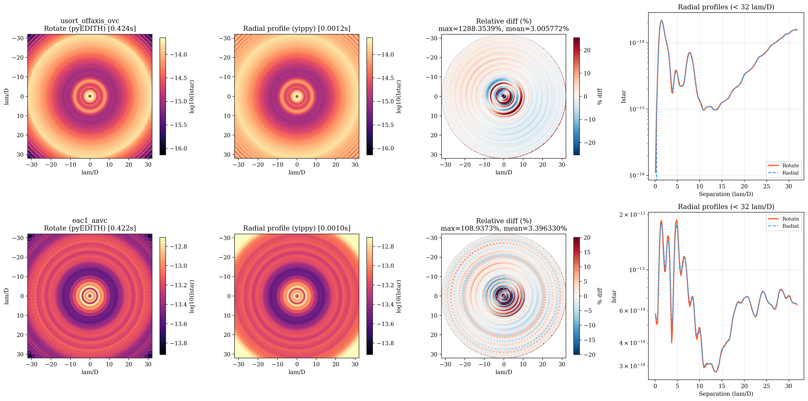

# Azimuthal Averaging of Stellar Intensity

## Background

The stellar intensity map from a YIP has real azimuthal structure, even for
radially symmetric (`1d`) coronagraphs. Airy rings and diffraction features
produce 70-90% azimuthal variation at moderate separations (e.g. r=10 pixels).

For yield calculations and integration time estimation, the azimuthally
**averaged** stellar intensity at a given separation is typically desired
rather than the raw position-angle-dependent value. This ensures that a
planet's background noise estimate depends only on its angular separation,
not its arbitrary position angle.

## Two Approaches

### Rotate-and-average (pyEDITH legacy)

Rotate the 2D stellar intensity image through many angles and average:

```python
from scipy.ndimage import rotate
import numpy as np

ntheta = 100
theta = np.linspace(0, 360, ntheta, endpoint=False)
result = np.zeros_like(istar_2d)
for angle in theta:
    result += rotate(istar_2d, angle, reshape=False, order=3)
result /= ntheta
```

This is conceptually simple but has several drawbacks:

- **Slow**: 100 cubic interpolation passes (~0.4s per coronagraph)
- **Rotation artifacts**: each `scipy.ndimage.rotate` call introduces
  cubic interpolation error that accumulates across rotations
- **Residual azimuthal structure**: the averaged result is not perfectly
  symmetric, so the value at (r, PA=45deg) differs from (r, PA=47deg)

### Radial profile projection (yippy)

Average the map on circles about the optical axis, tabulate that mean
against radius, fit a 1D interpolator, and project back onto the pixel
grid:

```python
from yippy import Coronagraph

coro = Coronagraph(yip_path, psf_trunc_ratio=0.3)

# Already available: coro.core_mean_intensity(separation)
# To get a 2D map:
r_lod = coro.separation_map()  # (npix, npix) separations in lam/D
istar_az_avg = coro.core_mean_intensity(r_lod)
```

This approach:

- **Fast**: a single vectorized interpolation call (~0.001s)
- **Artifact-free**: no rotation interpolation artifacts
- **True azimuthal mean**: mathematically exact average over all position
  angles, by definition
- **Perfectly symmetric**: every pixel at the same radius gets the exact
  same value

## Comparison

Tested on `usort_offaxis_ovc` and `eac1_aavc` coronagraphs (256x256,
pixscale=0.25 lam/D), comparing within 32 lam/D:

| Metric | usort | eac1 |
|---|---|---|
| Rotate time (100 angles) | 0.424s | 0.422s |
| Radial profile time | 0.001s | 0.001s |
| **Speedup** | **365x** | **424x** |
| Max relative difference | 1288% (1e-17 center) | 109% |
| Mean relative difference | 3.0% | 3.4% |

The large max relative differences occur at near-zero-signal pixels close
to the center where relative percentages blow up. The mean ~3% difference
is real and originates from rotation interpolation artifacts in the
rotate-and-average method.



**Left pair**: 2D maps (log scale) from each method appear visually
similar, with clear Airy ring structure. **Third column**: relative
difference map reveals systematic ring-pattern offsets at Airy ring
peaks/troughs. **Right**: radial profiles overlay, showing the radial
profile method (blue dashed) produces a smoother curve than the
rotate method (orange solid).

## Profile Sampling

The profile is tabulated every quarter pixel in radius, from the axis to the
farthest pixel center. At each radius the map is sampled at twice as many
position angles as the image has pixels on a side, with Keys cubic
interpolation, and the samples that fall inside the image are averaged. The
value at each radius is therefore the mean intensity at that radius.

Averaging the pixels whose centers fall in an annulus instead mixes a range of
radii wherever the profile is curved on the scale of the annulus: with
annuli about 1.4 pixels wide that is off by 1 to 3 percent typically, and by
up to 15 percent near the sharp minima of a vortex coronagraph's leakage
profile. The circle-sampled profile agrees with the exact mean to a few
tenths of a percent except within the deepest nulls.

At a stellar diameter between the tabulated ones, the profile is taken from
the stellar intensity map interpolated to that diameter (`stellar_intens`),
so the curve and the map an image simulator renders describe the same star.

## Recommendation

Use yippy's `core_mean_intensity` (radial profile) instead of the
rotate-and-average approach. It is faster, more accurate, and produces
cleaner azimuthal averages.

For the noise floor, divide by the post-processing factor:

```python
noise_floor_ayo = coro.core_mean_intensity(separation) / ppf
```

See also: [Noise Floor Conventions](examples/06_Noise_Floor_Conventions.ipynb)
