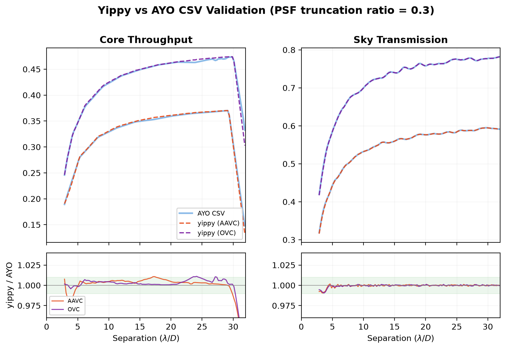

# Benchmarking: Yippy vs AYO

This page summarizes validation of yippy's coronagraph performance metrics
against AYO's IDL implementation, tested on two coronagraphs (AAVC and OVC)
with PSF truncation ratio 0.3. These historical results used synthesized-PSF
core measurements between offsets. That calculation now requires the explicit
`separation_step_lod=CORE_STEP_LOD` opt-in; default curves measure the shipped
PSFs at their own offsets and interpolate the resulting values.

Performance curves are PCHIP-interpolated between the YIP's offsets by
default. PCHIP preserves the shape of the tabulated curves without overshoot
near the inner working angle (Fritsch, F. N. and Carlson, R. E. 1980,
*SIAM J. Numer. Anal.* 17, 238). Set `interp_order=1` to restore the previous
linear interpolation. Outside the tabulated range, curves retain linear
end-segment extrapolation.

## Key Results

| Metric | AAVC mean (max err) | OVC mean (max err) |
|---|---|---|
| Core throughput | 0.9991 (10.3%) | 1.0002 (9.0%) |
| Sky transmission | 0.9994 (0.9%) | 0.9995 (1.0%) |
| Raw contrast | 1.0000 (< 0.1%) | 1.0000 (< 0.1%) |
| Noise floor | 1.0000 (< 0.1%) | 1.0000 (< 0.1%) |

The core-throughput extremes lie within 3 $\lambda/D$ of the image edge
(30 to 32 $\lambda/D$), where the core is cut off by the image border and
yippy's curve falls up to 10% below AYO's. Out to 29 $\lambda/D$ the core
throughput agrees to 2.0% (AAVC) and 1.1% (OVC), with means of 1.0031 and
1.0036; the largest difference is near the inner working angle, where the opt-in yippy calculation
measures the core of the PSF synthesized at each separation and AYO
interpolates linearly between the tabulated offsets.

Raw contrast and noise floor match exactly because both AYO and yippy
clamp values at the contrast floor ($10^{-10}$), which dominates across
most of the science region. The figure below focuses on throughput and
sky transmission, the two metrics with meaningful variation.




## Reproducible aperture accuracy benchmark

Run `tools/benchmark_apertures.py` from an environment with yippy and its
scientific dependencies installed. To measure the source checkout:

```sh
PYTHONPATH=src python tools/benchmark_apertures.py output/aperture-convergence
```

Add `--airy-only` for the analytic checks without downloading a package.
The script does not load historical commits or import test modules. Generated
CSVs belong in the ignored `output/` directory and are not checked in.

The analytic reference is the clear circular pupil in Born and Wolf,
*Principles of Optics*, seventh edition, section 8.5.2. The intensity is
`(pi / 4) * (2 * J1(pi*r) / (pi*r))**2` and encircled energy is
`1 - J0(pi*r)**2 - J1(pi*r)**2`, with radius in lambda/D. Images contain
256 by 256 samples at 0.25 and 0.5 lambda/D per pixel, shifted by zero or
0.3 pixel, without renormalizing the cropped wings. The half-maximum radius
is the numerical root of the analytic intensity ratio.

`airy.csv` compares 10x circular flux and half-maximum flux/area with these
analytic values. `convergence.csv` reports 5x, 10x, 20x and 40x measurements
of a shifted Airy and a native AAVC PSF near 20 lambda/D.
`shipped_gates.csv` compares 10x with 40x for every non-negative native offset
of the public `eac1_aavc_2d` package, including nominal locations outside the
image. The reference is the same current interpolant at finer quadrature,
not a historical implementation. The acceptance gate is 0.1% relative error
for both throughput and area, with the Airy gate tested independently.

Each run writes `provenance.json` with the yippy and dependency versions,
package release and archive MD5 from the public dataset registry, sampling,
image size, shift, aperture settings and precision. This identifies the
inputs and method without requiring Git history. The maintained tests
regenerate the Airy table with Git absent from PATH and assert its accuracy.
